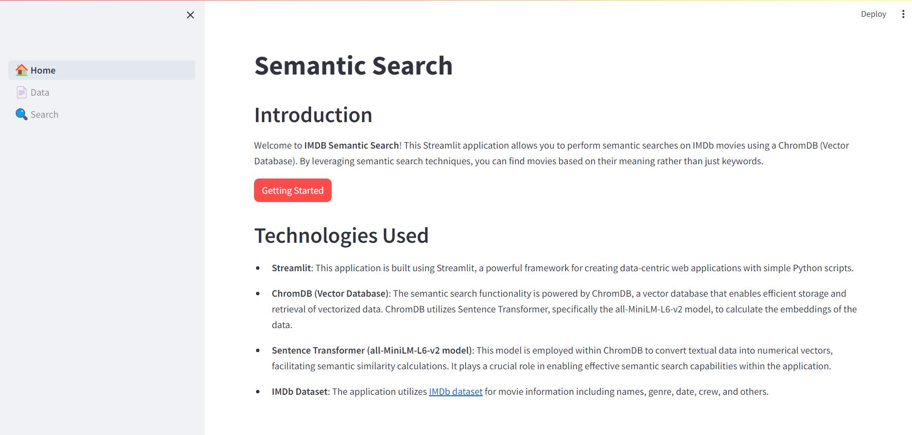
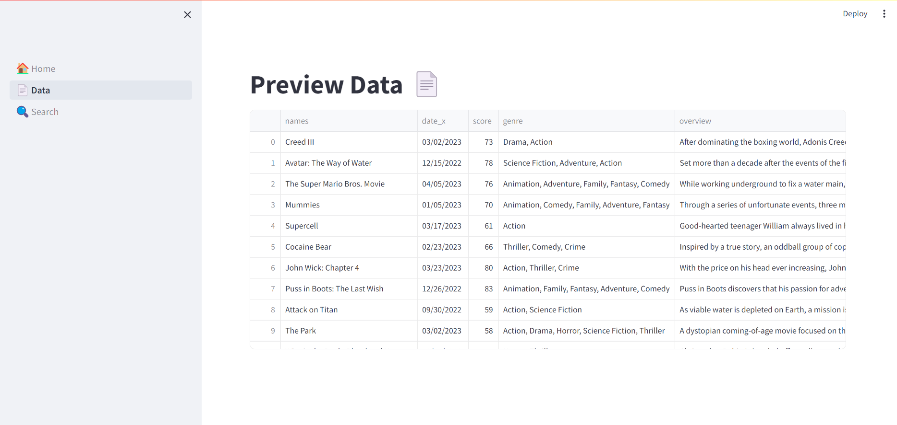

# IMDB Semantic Search

**Agenda:**

- [Introduction](#introduction)
- [Installation](#installation)
- [Technologies Used](#technologies-used)
- [About](#about)
- [Screenshots](#screenshots)

## Introduction

Welcome to **IMDB Semantic Search**! This Streamlit application allows you to perform semantic searches on IMDb movies using precomputed movie embeddings. By leveraging semantic search techniques, you can find movies based on their meaning rather than just keywords.

## Installation

To run this application locally, follow these steps:

1. Clone this repository to your local machine:

```bash
git clone https://gitlab.com/ahmad-nouh/machine-learning/imdb-semantic-search.git
```

2. Navigate to the project directory:

```bash
cd imdb-semantic-search
```

3. Install Python 3.11 and Poetry, then initialize your environment:

```bash
poetry env use 3.11
```

4. Install the required dependencies:

```bash
poetry install
```

5. Activate environment by running:
    ```bash
    source .venv/Scripts/activate # For windows
    ``` 
    or
    ```bash
    source .venv/bin/activate # For Linux & Mac
    ```

6. Run the Streamlit application (the embedding model downloads on first use):

```bash
streamlit run 1_🏠_Home.py
```


## Technologies Used

- **Streamlit**: This application is built using Streamlit, a powerful framework for creating data-centric web applications with simple Python scripts.

- **NumPy**: The app ranks precomputed movie embeddings by squared Euclidean distance.

- **Sentence Transformer (all-MiniLM-L6-v2 model)**: This model is used to convert textual data into numerical vectors, facilitating semantic similarity calculations. It plays a crucial role in enabling effective semantic search capabilities within the application.

- **IMDb Dataset**: The application utilizes [IMDb dataset](https://www.kaggle.com/datasets/ashpalsingh1525/imdb-movies-dataset?resource=download) for movie information including names, genre, date, crew, and others.


## About

This application was developed by [me](https://www.datascienceportfol.io/ahmad_nouh). It demonstrates the implementation of semantic search techniques for IMDb movies using Streamlit and sentence embeddings. Feel free to explore, modify, and use this application for learning and personal projects.

If you have any questions or feedback, please don't hesitate to contact me via email [ahmadnouh428@gmail.com].

Enjoy searching for your favorite movies with ease using **IMDB Semantic Search**!

## Screenshots
### Home


### Data


### Search
